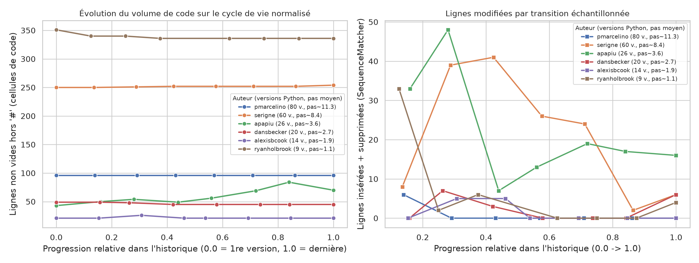
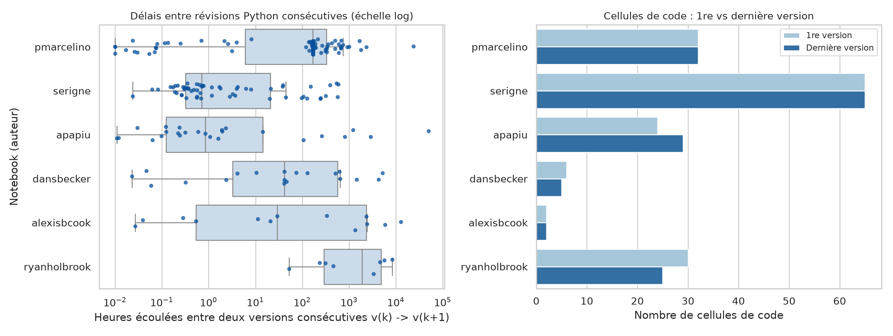
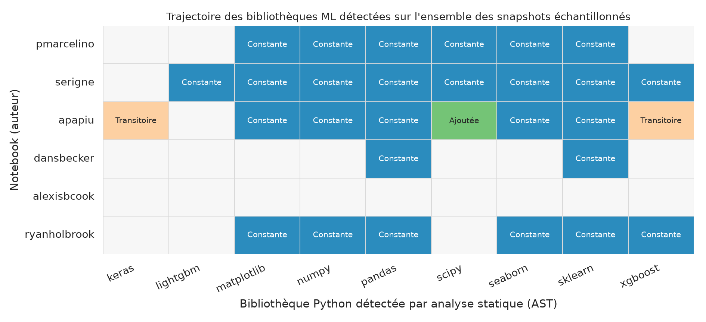

# Évolution des versions de notebooks Kaggle (House Prices)

Analyse exploratoire de l'historique de révision d'un sous-ensemble de notebooks publics de la
compétition Kaggle [House Prices - Advanced Regression Techniques](https://www.kaggle.com/competitions/house-prices-advanced-regression-techniques/code).

## Collecte des révisions sur Kaggle

La commande `kaggle kernels pull` du CLI officiel ne récupère que la dernière version publiée d'un
notebook. Pour reconstituer une trajectoire de versions :

1. `collect.py` ouvre une session HTTP sur la page publique de la compétition (`competitionId = 5407`)
   pour récupérer le cookie `XSRF-TOKEN`, avec un `User-Agent` dédié.
2. Il interroge les endpoints JSON internes `ListKernels` puis `ListKernelVersions` afin d'extraire :
   - les dates de toutes les versions Python valides (`all_python_revisions`), utilisées pour calculer
     les intervalles réels entre deux révisions consécutives `v(k) -> v(k+1)` ;
   - un échantillon régulier d'au plus `--max-versions` snapshots par notebook (8 par défaut, incluant
     toujours la première et la dernière version), téléchargés via `/kernels/scriptcontent/<id>/download`.
3. Chaque `.ipynb` est validé avec `nbformat` (schéma Jupyter v4, `relax_add_props=True` pour tolérer
   `execution_count` présent sur certaines cellules markdown des exports Kaggle 2016-2017) et son
   empreinte `SHA-256` est enregistrée dans `data/metadata.json`.

## Structure du dépôt

- `collect.py` : collecte depuis Kaggle ou vérification locale d'un manifeste (`--from-manifest`).
- `analyze.py` : contrôle des `SHA-256`, extraction des métriques par snapshot et des intervalles entre
  révisions consécutives ; produit `data/versions_evolution.csv`, `data/all_revisions_intervals.csv`
  et `data/notebooks_summary.csv`.
- `visualize.py` : génération des trois figures dans `figures/`.
- `tests/test_pipeline.py` : tests unitaires (`pytest`) sur le diff de lignes, l'extraction AST des
  imports, l'échantillonnage et la classification des trajectoires de bibliothèques.
- `data/` : manifeste `metadata.json`, 48 snapshots `.ipynb` figés (`data/notebooks/`) et CSV générés.
- `pyproject.toml`, `uv.lock`, `.python-version`, `Dockerfile` : environnement Python 3.12 verrouillé
  avec [uv](https://docs.astral.sh/uv/).

## Reproductibilité et exécution

### Reproduction hors-ligne de l'analyse et des figures

Avec Docker (exécution hors-ligne ; seul le `docker build` nécessite le réseau) :

```bash
docker build -t kaggle-house-prices-evolution .
docker run --rm --user "$(id -u):$(id -g)" -v "$(pwd)/data:/app/data" -v "$(pwd)/figures:/app/figures" kaggle-house-prices-evolution
git diff --exit-code data/*.csv
```

En local avec `uv` :

```bash
uv sync --frozen
uv run --frozen --no-dev python analyze.py
uv run --frozen --no-dev python visualize.py
uv run --frozen pytest
```

### Vérification du manifeste ou nouvelle collecte

Contrôler les empreintes `SHA-256` locales (et retélécharger uniquement les snapshots manquants) :

```bash
uv run --frozen --no-dev python collect.py --from-manifest data/metadata.json
```

Lancer une collecte dans un dossier distinct sans toucher à l'échantillon versionné dans `data/` :

```bash
uv run --frozen --no-dev python collect.py --notebooks 6 --max-versions 8 --out-dir data_nouvelle_collecte
```

## Définition des métriques

- `code_lines` : lignes non vides des cellules de code hors commentaires pleines lignes (`#`).
- `markdown_lines` : lignes non vides des cellules markdown (titres `#` inclus).
- `version_gap` : écart de numéro de version Kaggle entre deux snapshots échantillonnés successifs.
- `normalized_progress` : position relative dans l'historique du notebook, de `0.0` (1re version) à `1.0` (dernière).
- `lines_changed_between_sampled_snapshots` : somme des lignes insérées et supprimées (blocs remplacés
  inclus) via `difflib.SequenceMatcher(..., autojunk=False)` entre deux snapshots échantillonnés.
- `hours_since_prev_revision` : délai en heures entre deux versions Python consécutives `v(k)` et `v(k+1)`
  sur l'historique complet du notebook.

## Résultats observés (6 notebooks, 48 snapshots, 203 transitions consécutives)

L'échantillon réunit les 6 premiers notebooks Python (triés par votes) comptant au moins 3 versions,
soit de 9 à 80 versions Python par notebook (209 versions au total) :

1. Remaniements à volume constant (`serigne`, 60 versions, pas moyen 8,4) : le code passe seulement de
   250 à 254 lignes entre `v1` et `v60`, mais 20,9 lignes sont modifiées en moyenne par transition
   échantillonnée (remplacement de `rmse_cv` par `rmsle_cv`, nettoyage d'imports, retouches de figures),
   avec une médiane de 0,72 h entre deux révisions consécutives.
2. Croissance progressive et essais de bibliothèques (`apapiu`, 26 versions, pas moyen 3,6) : le code
   passe de 43 à 70 lignes (médiane de 0,84 h entre révisions). La détection AST met en évidence un
   ajout durable (`scipy`, à partir du snapshot `v15`) et deux présences transitoires (`xgboost`, absente
   des snapshots échantillonnés `v5` à `v15` puis réintroduite dès `v19`, et `keras`, présente uniquement
   en `v22`).
3. Artefact d'archive ancien (`pmarcelino`) et supports Kaggle Learn : sur `pmarcelino` (80 versions),
   le saut de `markdown_lines` de 4 (`v1`) à 165 (`v12`) provient très probablement d'un artefact
   d'export Kaggle 2017 sur `v001_877961.ipynb` (53 cellules markdown vides sur 55 alors que
   `lines_total_kaggle` vaut déjà 459 en `v1` et que la `v2`, vérifiée à part, contient bien les 55
   cellules remplies). Par ailleurs, trois notebooks très votés (`dansbecker`, `alexisbcook`, `ryanholbrook`) sont
   des supports Kaggle Learn aux révisions beaucoup plus espacées (médianes de 29 h à 1 887 h) ;
   `alexisbcook` délègue notamment ses traitements au module externe du cours `automl_tables_wrapper`.

### Figures

1. `figures/01_evolution_code_et_modifications.png` — volume de code et lignes modifiées sur le cycle normalisé :


2. `figures/02_intervalles_temporels_et_cellules.png` — délais entre révisions consécutives (plancher à `0,01 h` pour l'axe log) et nombre de cellules de code :


3. `figures/03_matrice_bibliotheques_ml.png` — trajectoires des bibliothèques ML détectées par AST :


## Limites méthodologiques

- Certains snapshots anciens présentent des anomalies d'export Kaggle (comme `pmarcelino` `v1`), qu'il
  faut confronter aux métadonnées avant interprétation.
- Le tri par `VOTE_COUNT` sur-représente des tutoriels populaires et supports Kaggle Learn (3 sur 6),
  peu représentatifs du travail itératif d'un compétiteur ordinaire.
- `lines_changed_between_sampled_snapshots` cumule les modifications sur `version_gap` versions : les
  amplitudes brutes ne sont pas directement comparables entre des pas d'échantillonnage très différents.
- `SequenceMatcher` opère sur les lignes de code concaténées et ne distingue pas le déplacement d'une
  cellule d'une réécriture.
- L'analyse AST se limite au périmètre `ML_LIBRARIES` et détecte la présence d'un `import`, non son
  usage effectif à l'exécution.
- `ListKernels` et `ListKernelVersions` sont des routes internes non garanties sur le long terme, d'où
  le versionnement local des 48 `.ipynb` et de leurs empreintes `SHA-256`.

## Licences et sources des données

Le code Python de ce dépôt est distribué sous licence MIT (`LICENSE`).

Les 48 notebooks de `data/notebooks/` proviennent de Kaggle et sont redistribués tels quels sous
[Apache License 2.0](https://www.apache.org/licenses/LICENSE-2.0) (`data/notebooks/LICENSE`) :

- Pedro Marcelino (`pmarcelino`) — [*Comprehensive data exploration with Python*](https://www.kaggle.com/code/pmarcelino/comprehensive-data-exploration-with-python)
- Serigne (`serigne`) — [*Stacked Regressions : Top 4% on LeaderBoard*](https://www.kaggle.com/code/serigne/stacked-regressions-top-4-on-leaderboard)
- Alexandru Papiu (`apapiu`) — [*Regularized Linear Models*](https://www.kaggle.com/code/apapiu/regularized-linear-models)
- Dan Becker (`dansbecker`) — [*Handling Missing Values*](https://www.kaggle.com/code/dansbecker/handling-missing-values)
- Alexis Cook (`alexisbcook`) — [*Exercise: Intro to AutoML*](https://www.kaggle.com/code/alexisbcook/exercise-intro-to-automl)
- Ryan Holbrook (`ryanholbrook`) — [*Feature Engineering for House Prices*](https://www.kaggle.com/code/ryanholbrook/feature-engineering-for-house-prices)
